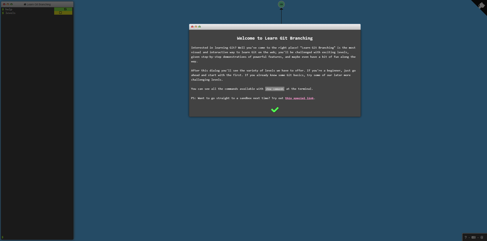
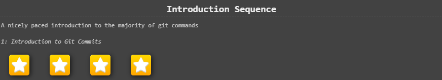
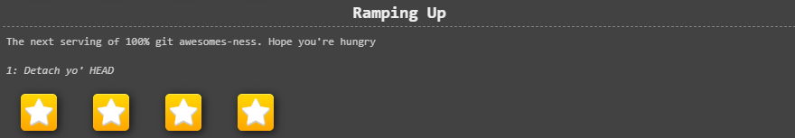
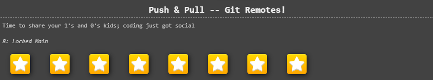

# HW2: Learn Git Branching

In this assignment, we are learning about git branching through an in-browser game located here: <https://learngitbranching.js.org>

### Complete the Introduction Sequence. Add a screenshot showing that you've completed this sequence. (2pt)

### Complete the Ramping Up Sequence. Add a screenshot showing that you've completed this sequence. (2pt)

### Complete the Push & Pull -- Git Remotes! Sequence. Note that this sequence is under the Remote tab in the "Select a level" dialog box. You can always refresh the website to get back to the "Select a level" dialog box, you won't lose your work.Add a screenshot showing that you've completed this sequence. (4pt)

### Describe your process for doing this homework. (If you used an AI assist, please tell us so here. It will not affect your grade as long as you tell us.) Answer this question by creating a README.md file in your HW2 folder. (1pt)

I followed along with the tutorials and updated my class notes to reflect the new git commands/arguments I learned (switch -c --detach, log, branch -f, reset, revert, cherry-pick). No AI was used.